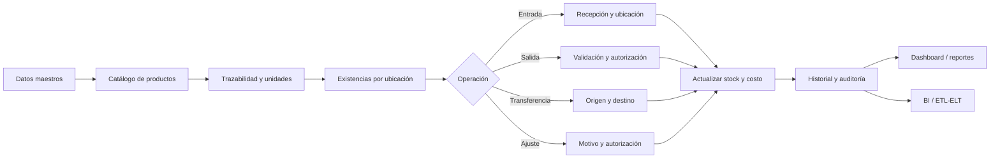
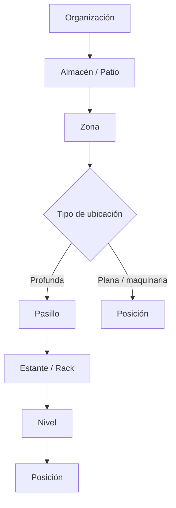
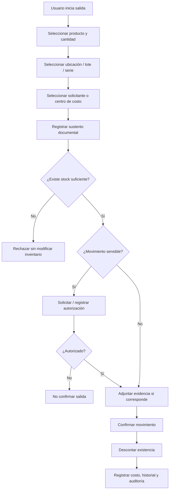
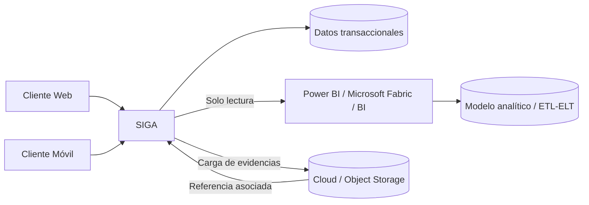
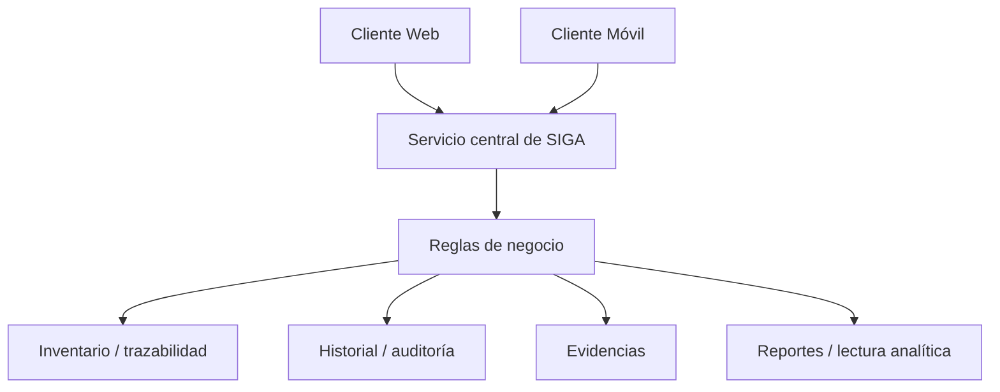
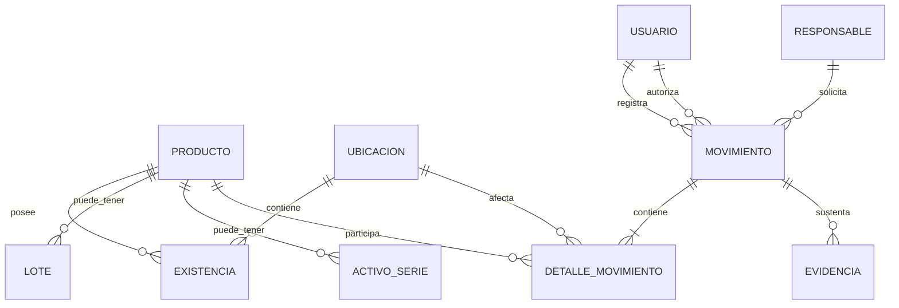
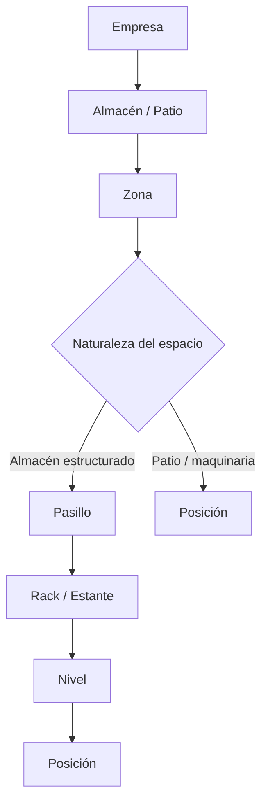
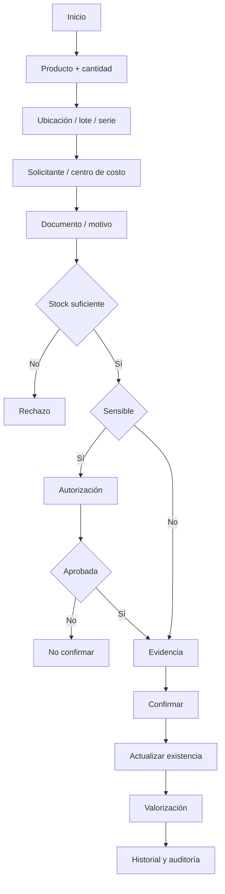
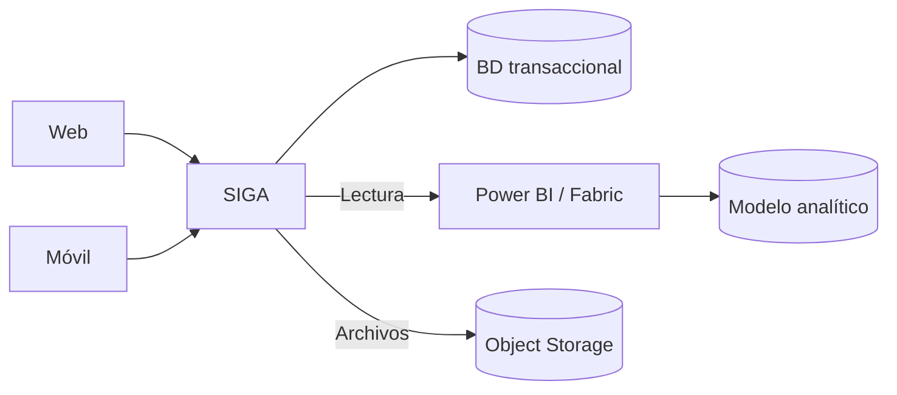

# Manual Administrativo — SIGA
## Sistema Integral de Gestión de Almacén para el Sector Mecánico/Minero

**Versión:** Final consolidada  
**Ámbito:** Gestión administrativa, procesos y lógica de negocio  
**Dominio:** Materiales industriales, insumos, repuestos y maquinaria pesada del sector mecánico/minero  
**Metodología de desarrollo:** Scrum  
**Documento relacionado:** Manual Técnico — SIGA

---

## Control documental

| Elemento | Definición |
|---|---|
| Documento | Manual Administrativo — SIGA |
| Propósito | Definir procesos, actores, reglas de negocio, controles, trazabilidad, reportes, indicadores y criterios administrativos del sistema |
| Alcance | Operación de almacén mecánico/minero mediante clientes web y móvil |
| Fuera de alcance | Detalles de implementación, infraestructura, diseño físico de base de datos y configuración específica de proveedores tecnológicos |
| Referencias de calidad | ISO/IEC 25010 como marco de calidad y recuperabilidad; lineamientos de seguridad de la información asociados a ISO/IEC 27001 |
| Contexto normativo | Catálogos y referencias documentales aplicables al contexto peruano/SUNAT cuando correspondan |
| Estado | Decisiones empresariales base validadas; catálogo y parámetros ampliables mediante configuración |

> **Nota de alcance normativo:** las referencias a ISO/IEC 25010, ISO/IEC 27001 y SUNAT se emplean como marcos de referencia para orientar el diseño y la trazabilidad. Este documento no declara certificación ISO ni reemplaza la evaluación contable, tributaria o legal que corresponda a una organización real.

---

# 1. Propósito

Este manual define los procesos administrativos y la lógica de negocio que orientan el funcionamiento de **SIGA — Sistema Integral de Gestión de Almacén**, diseñado para una empresa que administra materiales industriales, insumos, repuestos y maquinaria pesada vinculados con operaciones mecánicas y mineras.

El documento establece **qué debe ocurrir** en el negocio: quién puede realizar una operación, qué información debe registrarse, cómo se controla el inventario, qué reglas protegen la integridad de los movimientos, cómo se mantiene la trazabilidad y qué información administrativa debe obtenerse.

La implementación técnica de estas reglas —arquitectura, entidades, endpoints, almacenamiento, infraestructura, mecanismos de autenticación, estrategia física de respaldos y componentes de integración— corresponde al **Manual Técnico**.

---

# 2. Actores

| Actor | Responsabilidades principales |
|---|---|
| **Administrador** | Gestionar usuarios, roles, catálogos maestros, categorías, unidades de medida, parámetros, stock mínimo, auditoría, indicadores y reportes. |
| **Supervisor de Almacén** | Supervisar operaciones, validar movimientos sensibles y ejecutar o autorizar ajustes de inventario según permisos. |
| **Encargado de Almacén** | Consultar inventario, registrar entradas y salidas, asignar ubicaciones, verificar productos y mantener la trazabilidad operativa. |
| **Usuario Autorizado** | Consultar información y ejecutar únicamente las operaciones habilitadas por su rol. |
| **Usuario Móvil Autorizado** | Consultar inventario y registrar movimientos permitidos desde el cliente móvil bajo las mismas reglas del backend central. |
| **Solicitante / Responsable Operativo** | Persona, área, taller, cuadrilla o centro de costo que solicita o recibe materiales, insumos, repuestos o activos. |
| **Autorizador** | Perfil superior que valida movimientos sensibles cuando la política del negocio lo exige. |
| **Product Owner / Analista** | Definir necesidades, priorizar valor, validar comportamiento esperado y aprobar criterios de aceptación. |
| **Equipo Técnico** | Implementar, probar, desplegar, monitorear y mantener la solución conforme a las reglas aprobadas. |

## 2.1 Roles funcionales dentro de un movimiento

Los actores del sistema no deben confundirse con la responsabilidad registrada en una transacción. SIGA distingue:

- **Usuario registrador:** usuario autenticado que ejecuta la transacción. Su identidad se obtiene automáticamente de la sesión y no debe ser editable.
- **Responsable / solicitante:** persona, área o centro de costo que origina, solicita o recibe el recurso.
- **Autorizador:** usuario con privilegios superiores que valida operaciones sensibles. Su intervención es condicional y no debe ralentizar movimientos rutinarios que no la requieran.

---

# 3. Principios de negocio

1. El inventario debe mantenerse centralizado como fuente oficial de información.
2. Todo movimiento confirmado debe producir una variación trazable del inventario.
3. Una salida no puede superar la existencia disponible en la ubicación, lote, serie o activo seleccionado.
4. Toda operación relevante debe permitir identificar quién, cuándo, qué, cuánto, dónde, por qué y bajo qué sustento se realizó.
5. El acceso a funciones depende del rol y de los permisos asignados.
6. Los datos maestros deben existir y encontrarse activos antes de registrar movimientos que dependan de ellos.
7. Materiales, insumos, repuestos y maquinaria comparten el núcleo de inventario, pero aplican reglas de trazabilidad diferentes.
8. Los clientes web y móvil deben aplicar las mismas reglas de negocio porque ambos consumen el backend central.
9. Los movimientos históricos confirmados no deben alterarse como datos maestros. Las correcciones se realizan mediante movimientos compensatorios o ajustes autorizados.
10. Un error que comprometa la integridad del inventario debe impedir la confirmación de la operación.
11. El stock puede distribuirse en múltiples ubicaciones; el stock total es la consolidación de las existencias válidas.
12. Las unidades comerciales deben conservar equivalencia con una unidad base cuando sea necesaria una conversión.
13. La maquinaria se administra como activo individual identificable, no únicamente como cantidad agregada.
14. Las operaciones sensibles deben contar con autorización cuando la política configurada así lo determine.
15. SIGA debe conservar evidencia suficiente para auditoría administrativa, trazabilidad física y análisis posterior.
16. La analítica no debe alterar el núcleo transaccional: los consumidores analíticos acceden en modalidad de lectura.
17. La valorización de inventario tiene finalidad de control gerencial básico y no convierte a SIGA en un sistema contable o tributario integral.

---

# 4. Proceso general de gestión

El proceso administrativo de SIGA se organiza en una secuencia que inicia con los datos maestros y concluye con control, análisis y auditoría:

1. **Configuración de datos maestros:** categorías, productos, unidades de medida, ubicaciones, responsables, centros de costo, tipos de movimiento y parámetros.
2. **Registro y clasificación del catálogo:** materiales, insumos, repuestos y maquinaria pesada con atributos específicos.
3. **Asignación de trazabilidad:** serie/activo, lote/colada, vencimiento o control por cantidad según la naturaleza del producto.
4. **Definición de existencias:** asociación del producto con una o más ubicaciones físicas.
5. **Registro de entradas:** recepción, validación, ubicación, sustento documental y actualización de existencias.
6. **Registro de salidas:** solicitud, validación de disponibilidad, autorización condicional, evidencia y descuento de existencias.
7. **Transferencias internas:** traslado entre ubicaciones sin alterar el stock total de la organización.
8. **Ajustes de inventario:** regularización controlada de sobrantes, faltantes, mermas, daños o diferencias de conteo.
9. **Actualización de stock y costo:** actualización física y, cuando corresponda, del costo promedio ponderado.
10. **Historial y auditoría:** conservación inmutable de la trazabilidad.
11. **Dashboard y reportes:** exposición de información operativa, analítica y de valorización.
12. **Interoperabilidad:** consumo analítico externo y almacenamiento desacoplado de evidencias digitales.

---

# 5. Gestión de usuarios

## 5.1 Objetivo

Controlar quién puede acceder a SIGA y qué operaciones puede ejecutar.

## 5.2 Flujo

1. El administrador registra al usuario.
2. Se establecen sus datos, estado y ámbito de operación.
3. Se asigna un rol.
4. El usuario utiliza sus credenciales.
5. El sistema autentica la identidad.
6. El backend determina las operaciones permitidas.
7. Las acciones relevantes quedan asociadas al usuario autenticado.
8. Si el usuario es desactivado, no debe poder iniciar nuevas sesiones.

## 5.3 Reglas

- Desactivar un usuario no elimina su historial.
- Los movimientos ya registrados deben conservar la identidad histórica del registrador.
- Los privilegios sensibles deben otorgarse bajo el principio de mínimo acceso necesario.
- La identidad del registrador de una transacción no puede ser digitada manualmente para sustituir al usuario autenticado.

---

# 6. Gestión de roles y permisos

Los permisos se administran por rol y pueden complementarse con reglas condicionales para movimientos sensibles.

| Función | Administrador | Supervisor de Almacén | Encargado de Almacén | Usuario Autorizado | Usuario Móvil |
|---|---:|---:|---:|---:|---:|
| Acceso al sistema | Sí | Sí | Sí | Sí | Sí |
| Gestionar usuarios/roles | Sí | No | No | No | No |
| Gestionar catálogos maestros | Sí | Según permiso | Consulta | Consulta | Consulta |
| Consultar inventario | Sí | Sí | Sí | Sí | Sí |
| Registrar entradas | Sí | Sí | Sí | Según permiso | Según permiso |
| Registrar salidas | Sí | Sí | Sí | Según permiso | Según permiso |
| Transferir ubicaciones | Sí | Sí | Sí | Según permiso | Según permiso |
| Ejecutar ajustes | Sí | Sí | No por defecto | No | No |
| Autorizar movimientos sensibles | Sí | Sí | No por defecto | No | No |
| Reportes | Sí | Sí | Sí | Consulta según rol | No por defecto |
| Historial | Sí | Sí | Sí | Consulta según rol | Consulta limitada |
| Auditoría | Sí | Según permiso | No | No | No |

> La matriz es una línea base. La autorización definitiva se parametriza según la organización, manteniendo consistencia con los requisitos funcionales y criterios de aceptación.

---

# 7. Gestión de categorías

## 7.1 Objetivo

Organizar el catálogo industrial bajo una clasificación coherente con las operaciones mecánicas y mineras, permitiendo crecimiento futuro sin duplicar productos.

## 7.2 Categorías principales validadas

SIGA utilizará como clasificación de negocio de primer nivel:

| Categoría | Criterio |
|---|---|
| **Materiales** | Elementos que serán cortados, soldados, mecanizados o transformados para fabricar o reparar otro elemento. |
| **Insumos** | Elementos que se consumen, degradan, evaporan o desechan durante la operación. |
| **Repuestos** | Piezas terminadas destinadas a reemplazar componentes existentes. |
| **Maquinaria pesada** | Activos físicos individualizados utilizados en operaciones mecánicas, mineras, de transporte, procesamiento o soporte. |

## 7.3 Tipos base de materiales

La clasificación es ampliable y sirve como base inicial:

- **Aceros y aleaciones estructurales:** planchas estructurales, perfiles H/I/U, vigas, tubos sin costura, barras macizas y perforadas.
- **Materiales antiabrasivos y de desgaste:** planchas AR400/AR500, aceros bimetálicos y recubrimientos duros.
- **Materiales de soldadura y corte:** electrodos, alambres tubulares, varillas de aporte y fundentes.
- **Elementos de fijación de alta resistencia:** pernos estructurales, tuercas de seguridad, arandelas y espárragos.
- **Polímeros, cauchos y aislamientos industriales:** poliuretano, caucho, neopreno, PTFE y otros materiales industriales mecanizables.

## 7.4 Tipos base de maquinaria

- **Movimiento de tierras:** excavadoras hidráulicas, bulldozers, motoniveladoras, retroexcavadoras.
- **Carga y transporte:** cargadores frontales, camiones mineros y dumpers articulados.
- **Perforación y extracción:** jumbos, perforadoras rotativas, martillos hidráulicos y equipos equivalentes.
- **Procesamiento y trituración:** chancadoras, molinos, zarandas y fajas transportadoras.
- **Izaje y manipulación:** grúas móviles, grúas puente, montacargas y manipuladores telescópicos.
- **Equipos auxiliares y de soporte:** grupos electrógenos, torres de iluminación, compresoras y motobombas.

## 7.5 Reglas de clasificación

- Una categoría debe ser identificable y no duplicar otra con el mismo propósito.
- Un producto debe pertenecer a una categoría válida.
- La desactivación de una categoría no debe romper referencias históricas.
- La clasificación puede ampliarse mediante configuración sin alterar las reglas fundamentales.
- Ante duda funcional:
  - si se transforma para crear/reparar otro elemento → **Material**;
  - si reemplaza una pieza terminada → **Repuesto**;
  - si se consume durante la operación → **Insumo**;
  - si constituye un activo operativo individualizable → **Maquinaria pesada**.

---

# 8. Gestión de productos, unidades y trazabilidad

## 8.1 Objetivo

Mantener un catálogo único y confiable que permita operar inventario físico, trazabilidad, ubicación, valorización y reportes.

## 8.2 Datos generales del producto

Como base, cada producto debe contemplar:

- código interno/SKU;
- nombre o descripción;
- categoría y tipo;
- estado;
- unidad de almacén;
- unidad base cuando corresponda;
- factor de conversión cuando corresponda;
- stock mínimo/punto de reposición;
- información técnica;
- configuración de trazabilidad;
- configuración de vencimiento;
- configuración de serialización;
- información de costo aplicable.

## 8.3 Catálogo de unidades de medida

### A. Unidades científicas y estandarizadas

| Magnitud | Unidades base admitidas |
|---|---|
| Masa / peso | kilogramo (kg), tonelada métrica (t) |
| Longitud | metro (m), milímetro (mm) |
| Área | metro cuadrado (m²) |
| Volumen | metro cúbico (m³), litro (L), galón (gal) |

### B. Unidades discretas y logísticas

- Unidad (und)
- Juego / kit
- Par

### C. Unidades comerciales o de presentación

- Plancha
- Barra
- Tubo
- Rollo
- Cilindro
- Tambor

## 8.4 Regla de equivalencia

Cuando una unidad comercial represente una cantidad medible en otra unidad, el producto debe definir:

- **Unidad de almacén:** cómo se cuenta o despacha físicamente.
- **Unidad base:** cómo se mide para cálculos técnicos.
- **Factor de conversión:** relación matemática entre ambas.

**Ejemplo administrativo:** un rollo de cable configurado como `1 rollo = 500 m` permite registrar una salida de `0.5 rollos` y conservar la equivalencia de `250 m`.

El factor de conversión pertenece a la configuración del producto y debe mantenerse trazable cuando afecte operaciones históricas.

## 8.5 Reglas de trazabilidad

SIGA maneja dos niveles principales:

### 8.5.1 Maquinaria — trazabilidad unitaria estricta

- Cada máquina es un activo único.
- **Número de serie VIN/PIN:** obligatorio.
- **Código de activo interno:** obligatorio.
- Puede registrarse marca, modelo, horómetro y estado operativo.
- El sistema debe conocer qué activos específicos se encuentran disponibles, en mantenimiento, inoperativos o en otra ubicación.

Estados base sugeridos:
- Operativo
- En mantenimiento
- Inoperativo
- En tránsito
- Fuera de servicio

### 8.5.2 Repuestos — trazabilidad condicional

- Por defecto se controlan por cantidad.
- El producto puede configurarse como **“requiere número de serie”**.
- Si el repuesto es serializado, la serie debe registrarse en entrada, ubicación, salida y trazabilidad.

### 8.5.3 Materiales — trazabilidad por lote/colada

- Se controlan por cantidad y unidad de medida.
- No requieren serie individual.
- Pueden registrar **número de lote o número de colada**.
- La trazabilidad debe permitir identificar otras existencias relacionadas con el mismo lote ante una incidencia de calidad.

### 8.5.4 Insumos — lote y caducidad

- Se controlan por cantidad.
- Pueden requerir lote y fecha de vencimiento según la configuración del producto.
- El sistema debe permitir identificar insumos vencidos o próximos a vencer.
- La política de despacho puede considerar vencimiento cuando corresponda.

## 8.6 Edición, desactivación y reactivación de productos

La edición de un producto sustituye su ficha editable completa y su conjunto completo de conversiones. La pantalla debe cargar la versión vigente y enviarla como control de concurrencia; si otra sesión modificó antes el producto, SIGA rechaza la edición y exige recargar. Una solicitud que no cambia ningún valor conserva la versión, las fechas y las conversiones y no genera un evento administrativo nuevo.

La desactivación es lógica: no borra el producto, existencias, lotes, activos, conversiones históricas ni movimientos. Puede desactivarse un producto aunque una categoría o unidad que ya utilizaba haya quedado inactiva; esas referencias solo pueden conservarse para dejar el producto inactivo, no sustituirse por otras referencias inactivas. La reactivación exige seleccionar categoría y unidades vigentes y presentar conversiones válidas. Inventory recibe el cambio de forma asíncrona y conserva sus referencias e historial; no existe consulta síncrona entre ambos esquemas durante la edición.

SKU, nombre, categoría, tipo, unidades, stock mínimo, atributos técnicos y los cuatro indicadores de trazabilidad pueden editarse. Los indicadores `requiresLot`, `requiresHeatNumber`, `requiresExpiry` y `requiresSerial` siguen siendo independientes. Los cambios rigen las operaciones posteriores a la actualización de la proyección y no reescriben movimientos confirmados.

---

# 9. Gestión de inventario, ubicaciones y existencias

## 9.1 Consulta de inventario

El usuario autorizado debe poder consultar:

- producto y descripción;
- categoría/tipo;
- stock total;
- stock por ubicación;
- unidad de almacén y unidad base;
- estado de stock;
- lote/colada cuando corresponda;
- serie/activo cuando corresponda;
- vencimiento cuando corresponda;
- costo promedio y valorización cuando su rol lo permita;
- estado operativo de maquinaria;
- información técnica disponible.

## 9.2 Jerarquía de ubicaciones

SIGA representará el espacio físico mediante una jerarquía flexible.

### Estructura profunda

Aplicable a repuestos, materiales menores e insumos:

**Almacén → Zona → Pasillo → Estante/Rack → Nivel → Posición**

### Estructura plana

Aplicable a maquinaria pesada o elementos voluminosos:

**Almacén/Patio → Zona → Posición**

El sistema debe permitir, como mínimo, áreas como:

- almacén principal;
- patio de maquinaria;
- taller de mantenimiento;
- zona de recepción;
- zona de cuarentena;
- zona de despacho;
- otras áreas configurables.

## 9.3 Stock multi-ubicación

Un mismo producto puede encontrarse simultáneamente en varias ubicaciones.

**Regla:**

`Stock total del producto = suma de existencias disponibles en todas sus ubicaciones válidas`

Ejemplo:

- Rodamiento X — Rack A: 30 und
- Rodamiento X — Rack B: 20 und
- **Stock total:** 50 und

Una entrada debe identificar su ubicación destino. Una salida debe descontar de una ubicación con saldo suficiente. Una transferencia interna disminuye la existencia de origen y aumenta la de destino sin alterar el stock total organizacional.

## 9.4 Estrategias de despacho

SIGA no impone una única estrategia para todos los productos. Según configuración y naturaleza del inventario, podrá considerarse:

- selección manual controlada;
- FIFO cuando corresponda;
- FEFO para productos con vencimiento;
- selección por lote;
- selección por serie/activo.

---

# 10. Entrada de productos

## 10.1 Objetivo

Registrar el ingreso físico y administrativo de materiales, insumos, repuestos o maquinaria, conservando ubicación, costo, trazabilidad y sustento.

## 10.2 Flujo administrativo

1. El registrador inicia una entrada.
2. Selecciona el producto.
3. Registra cantidad y unidad.
4. Registra la ubicación destino.
5. Completa lote/colada, vencimiento, serie o activo cuando corresponda.
6. Registra el costo unitario de ingreso cuando aplique.
7. Registra tipo y número de documento de referencia.
8. Asocia solicitante/responsable cuando corresponda.
9. Adjunta evidencia digital si existe o si la política la exige.
10. El sistema valida datos, permisos y consistencia.
11. El usuario confirma.
12. Se incrementa la existencia de la ubicación.
13. Se actualiza el costo promedio cuando corresponda.
14. Se registra el movimiento y su auditoría.

## 10.3 Reglas

- Una entrada confirmada debe generar un movimiento trazable.
- La ubicación destino es obligatoria.
- Los datos de serie/lote/vencimiento son obligatorios cuando la configuración del producto así lo determine.
- El costo de ingreso debe conservarse para la valorización cuando el producto se gestione económicamente.
- Una entrada fallida no debe modificar parcialmente el stock.

---

# 11. Salida de productos

## 11.1 Objetivo

Registrar el despacho, consumo, retiro o entrega de inventario, garantizando disponibilidad, responsabilidad, autorización condicional y evidencia.

## 11.2 Flujo administrativo

1. El registrador inicia una salida.
2. Selecciona producto, cantidad y unidad.
3. Selecciona ubicación de origen.
4. Identifica lote, serie o activo cuando corresponda.
5. Selecciona al responsable/solicitante o centro de costo.
6. Registra el motivo/tipo de operación y documento de referencia.
7. El sistema valida la existencia específica.
8. El sistema determina si el movimiento requiere autorización.
9. Si requiere autorización, el movimiento debe ser validado por un autorizador habilitado.
10. Se adjunta evidencia digital cuando corresponda.
11. Se confirma la salida.
12. Se descuenta la existencia.
13. Se valoriza la salida con el costo promedio vigente.
14. Se registra historial y auditoría.

## 11.3 Regla crítica de disponibilidad

Si:

`cantidad_salida > existencia_disponible_en_ubicacion`

entonces:

- rechazar la operación;
- no modificar stock;
- informar la causa.

Si:

`cantidad_salida <= existencia_disponible_en_ubicacion`

entonces:

- continuar las validaciones;
- aplicar autorización si corresponde;
- registrar salida;
- actualizar existencia;
- registrar trazabilidad.

## 11.4 Autorización condicional

No se exige autorización superior para cada salida ordinaria. Debe activarse, como mínimo, para operaciones definidas como sensibles, por ejemplo:

- salida o traslado de maquinaria pesada;
- repuestos de alto valor según política;
- ajustes de inventario;
- otras operaciones configuradas por la administración.

## 11.5 Flujo de salida con autorización y evidencia

---

# 12. Movimientos, transferencias, ajustes y actualización de stock

## 12.1 Tipos administrativos de movimiento

SIGA distingue, como mínimo:

- Entrada
- Salida
- Transferencia interna
- Ajuste positivo
- Ajuste negativo

La clasificación administrativa puede relacionarse con catálogos normativos o internos sin sustituir la naturaleza real del movimiento.

## 12.2 Transferencias internas

Una transferencia mueve inventario entre ubicaciones.

Reglas:

- debe identificar ubicación origen y destino;
- el origen debe tener existencia suficiente;
- no modifica el stock total de la organización;
- sí modifica la distribución física;
- conserva lote, serie o activo cuando corresponda;
- debe quedar registrada en historial.

## 12.3 Ajustes manuales de inventario

Los descuadres no deben ocultarse como entradas o salidas ordinarias.

### Ajuste positivo
Se utiliza para sobrantes debidamente justificados.

### Ajuste negativo
Se utiliza para faltantes, mermas, daño, vencimiento u otras pérdidas justificadas.

### Reglas

- motivo obligatorio;
- permisos restringidos;
- autorización superior o privilegio específico;
- evidencia digital cuando corresponda;
- no eliminar ni modificar el movimiento histórico que originó la diferencia;
- registrar registrador y autorizador;
- mantener efecto valorizado cuando corresponda.

Motivos base:
- Conteo físico
- Merma
- Daño en almacén
- Vencimiento
- Diferencia de inventario
- Error de registro anterior
- Otro motivo autorizado

## 12.4 Actualización de stock

Conceptualmente:

`Stock posterior = Stock anterior + entradas - salidas ± ajustes`

Para una transferencia interna:

`Stock total posterior = Stock total anterior`

pero cambia la distribución entre ubicaciones.

La disponibilidad consolidada debe ser consistente con el detalle de existencias, movimientos, lotes, series y activos.

## 12.5 Costo promedio ponderado simplificado

SIGA utilizará costo promedio ponderado para control financiero básico.

Ante una entrada valorizada:

`Nuevo costo promedio = (Valor del stock anterior + Valor de la nueva entrada) / Cantidad total resultante`

Las salidas utilizan el costo promedio vigente en el momento de la operación.

Este mecanismo tiene finalidad de **gestión de inventario y valorización gerencial**. SIGA no calcula impuestos ni sustituye un ERP contable.

---

# 13. Stock mínimo, vencimiento y alertas

## 13.1 Stock mínimo

Cada producto puede definir un nivel mínimo o punto de reposición.

- Si `stock_actual <= stock_minimo` → **BAJO STOCK / REPOSICIÓN**
- Si `stock_actual = 0` → **SIN STOCK / ALERTA CRÍTICA**
- Si `stock_actual > stock_minimo` → **NORMAL**

La condición debe ser coherente en web, móvil, reportes e integraciones.

## 13.2 Vencimientos

Para productos configurados con caducidad:

- el sistema debe conservar fecha de vencimiento por lote;
- debe identificar productos vencidos;
- debe permitir alertas de vencimiento próximo;
- el dashboard puede consolidar alertas a 30/60 días;
- la salida puede priorizar FEFO cuando la política del producto lo establezca.

## 13.3 Conteos físicos

SIGA debe permitir registrar resultados de conteos físicos o procesos de verificación necesarios para:

- detectar diferencias;
- sustentar ajustes;
- calcular exactitud de inventario;
- conservar evidencia de auditoría.

---

# 14. Historial, trazabilidad, documentación y evidencia

## 14.1 Principio de inmutabilidad

El historial debe permitir reconstruir lo ocurrido. Los movimientos confirmados no se editan como registros maestros; cualquier corrección debe conservar el movimiento original y generar la operación compensatoria correspondiente.

## 14.2 Información obligatoria del movimiento

### Datos transaccionales

- ID/código correlativo del movimiento;
- tipo de movimiento;
- fecha y hora;
- usuario registrador;
- producto;
- cantidad;
- unidad;
- ubicación origen y/o destino;
- estado del movimiento.

### Datos de trazabilidad del producto

- maquinaria: serie VIN/PIN y código de activo;
- repuesto serializado: número de serie;
- materiales: lote/colada cuando corresponda;
- insumos: lote y vencimiento cuando la configuración lo requiera.

### Datos de responsabilidad

- solicitante/responsable/centro de costo;
- autorizador cuando corresponda.

### Sustento documental

SIGA debe permitir registrar:

- tipo de documento;
- serie/número o referencia;
- tipo/motivo de operación;
- observaciones;
- evidencia digital asociada.

## 14.3 Referencias documentales y contexto SUNAT

Cuando el negocio utilice documentos vinculados con operaciones sujetas a catálogos SUNAT, SIGA debe permitir conservar códigos y referencias de manera parametrizable.

Como base administrativa pueden contemplarse referencias como:

- Factura;
- Guía de Remisión Remitente;
- otros documentos admitidos por el catálogo aplicable;
- documentos internos como vales, órdenes de trabajo o actas, diferenciándolos de los comprobantes tributarios.

Los catálogos normativos deben mantenerse configurables y actualizables. SIGA no debe asumir que un documento interno equivale a un comprobante tributario.

## 14.4 Evidencia digital

SIGA permitirá asociar evidencia digital a entradas, salidas y ajustes.

Formatos funcionales previstos:
- PDF
- JPG/JPEG
- PNG

Casos de uso:
- fotografía del estado de una máquina al despacho;
- fotografía de un repuesto de alto valor;
- guía, vale o acta firmada;
- evidencia de daño, merma o diferencia;
- documentación de recepción.

La evidencia complementa la trazabilidad, pero no reemplaza los campos estructurados del movimiento.

## 14.5 Auditoría

La auditoría debe permitir identificar:

- quién ejecutó la operación;
- quién la solicitó;
- quién la autorizó, si aplicó;
- qué operación se realizó;
- fecha y hora;
- producto/activo afectado;
- ubicación;
- resultado;
- sustento y observaciones relevantes.

El acceso a auditoría se restringe a perfiles autorizados.

---

# 15. Dashboard, indicadores y preparación analítica

## 15.1 Estrategia de visualización

SIGA divide la información en dos niveles.

### Nivel 1 — Dashboard operativo

Presenta aproximadamente **6 a 8 indicadores y alertas prioritarias** para conocer la salud actual del almacén sin saturar la interfaz.

### Nivel 2 — Indicadores analíticos

Se consultan mediante reportes o herramientas analíticas externas para estudiar tendencias, precisión, consumo, valorización y desempeño histórico.

## 15.2 KPI principales del dashboard

El dashboard debe priorizar una selección de los siguientes:

| KPI / Alerta | Propósito |
|---|---|
| **Valor total inmovilizado** | Conocer el valor valorizado del inventario disponible. |
| **Disponibilidad de activos** | Mostrar porcentaje de maquinaria operativa respecto del total controlado. |
| **Productos bajo mínimo** | Detectar necesidades de reposición. |
| **Productos sin stock** | Detectar roturas de stock. |
| **Insumos próximos a vencer** | Prevenir pérdida de materiales por caducidad. |
| **Entradas del período** | Visualizar volumen/cantidad/valor ingresado. |
| **Salidas del período** | Visualizar consumo/despacho del período. |
| **Alertas o movimientos sensibles** | Mostrar ajustes, salidas de alto valor u operaciones que requieran atención. |

El dashboard puede consolidar varias alertas en una sola tarjeta para mantener entre 6 y 8 elementos visuales principales.

## 15.3 Indicadores analíticos

### Exactitud de Registro de Inventario (IRA)

Mide la concordancia entre registros y conteos físicos bajo el criterio definido por la organización.

`IRA (%) = (Registros/ítems sin diferencia / Registros/ítems verificados) × 100`

El método exacto de conteo debe documentarse para que el indicador sea comparable entre períodos.

### Rotación de inventario

`Rotación = Valor de salidas/consumo del período / Valor promedio del inventario`

Permite conocer la frecuencia con la que se renueva el inventario.

### Cobertura de stock

`Cobertura (días) = Stock disponible / Consumo promedio diario`

Debe calcularse sobre unidades comparables y un período de consumo definido.

### Tasa de mermas y ajustes

Relaciona los ajustes negativos valorizados con el valor movilizado o inventario de referencia del período, según la política analítica adoptada.

### Concentración del gasto operativo

Distribuye las salidas valorizadas por centro de costo, área, taller, cuadrilla u otra unidad responsable.

### Disponibilidad de maquinaria

`Disponibilidad (%) = Activos operativos / Activos controlados × 100`

Puede complementarse con:
- activos en mantenimiento;
- activos inoperativos;
- activos en tránsito;
- tiempo por estado cuando exista información suficiente.

### Indicadores adicionales habilitados por los datos

- consumo por categoría;
- consumo por ubicación;
- consumo por centro de costo;
- productos sin movimiento;
- antigüedad del inventario;
- valor de inventario por categoría;
- frecuencia de ajustes;
- lotes próximos a vencer;
- cumplimiento de reposición;
- movimientos por usuario/área;
- tendencia mensual de entradas y salidas.

## 15.4 Preparación para análisis externo

SIGA debe conservar datos transaccionales consistentes y permitir su explotación en modo lectura por herramientas BI o procesos ETL/ELT, sin que las consultas analíticas modifiquen la operación del almacén.

---

# 16. Reportes

## 16.1 Objetivo

Proporcionar información operativa, administrativa, de trazabilidad y valorización para apoyar control, auditoría y toma de decisiones.

## 16.2 Catálogo base

| Nº | Reporte | Contenido principal |
|---:|---|---|
| 1 | **Inventario Actual Consolidado** | Stock total y distribución por almacén, zona y ubicación. |
| 2 | **Kardex / Historial de Producto** | Entradas, salidas, transferencias, ajustes y saldos por período. |
| 3 | **Trazabilidad de Maquinaria y Activos** | Código de activo, serie, ubicación, estado y movimientos. |
| 4 | **Trazabilidad de Lotes y Vencimientos** | Lote/colada, existencias relacionadas, movimientos y caducidad. |
| 5 | **Flujo de Movimientos** | Entradas/salidas filtrables por período, tipo, producto, usuario, almacén o documento. |
| 6 | **Alerta de Reposición** | Productos bajo mínimo o sin stock. |
| 7 | **Consumo por Centro de Costo** | Salidas físicas y valorizadas agrupadas por área/solicitante. |
| 8 | **Auditoría de Ajustes y Movimientos Sensibles** | Ajustes, mermas, sobrantes, salidas sensibles, registrador y autorizador. |
| 9 | **Valorización de Inventario** | Cantidad, costo promedio y valor total por producto/categoría/ubicación. |
| 10 | **Inventario por Ubicación** | Existencias físicas por almacén, zona, rack, posición o patio. |
| 11 | **Insumos Próximos a Vencer / Vencidos** | Lotes y cantidades según horizonte de vencimiento. |
| 12 | **Conteos y Exactitud de Inventario** | Resultados de conteo, diferencias, ajustes derivados e IRA. |

## 16.3 Valorización

La valorización se basa en el costo promedio ponderado simplificado. El reporte puede expresarse en la moneda operativa configurada por la organización y debe indicar el período o fecha de corte.

## 16.4 Exportación

Los reportes deben poder consultarse con filtros. La exportación a formatos de intercambio podrá habilitarse según el alcance técnico del proyecto y las necesidades de interoperabilidad.

---

# 17. Auditoría y control administrativo

## 17.1 Objetivo

Mantener responsabilidad, trazabilidad y evidencia sobre operaciones que afecten inventario, configuración o seguridad.

## 17.2 Eventos auditables

Como mínimo:

- autenticación y accesos relevantes;
- creación/desactivación de usuarios;
- cambios de roles/permisos;
- cambios de datos maestros críticos;
- entradas;
- salidas;
- transferencias;
- ajustes;
- autorizaciones;
- cambios de stock mínimo;
- asociación de evidencia;
- operaciones sensibles;
- procesos de restauración y pruebas de continuidad cuando corresponda.

## 17.3 Controles administrativos

| Control | Propósito |
|---|---|
| Roles y permisos | Restringir funciones |
| Validación de existencia | Evitar stock negativo o inconsistente |
| Multi-ubicación | Conocer distribución física real |
| Series y activos | Trazabilidad unitaria |
| Lotes/coladas | Trazabilidad agrupada |
| Vencimiento | Evitar despacho no deseado de insumos caducados |
| Autorización condicional | Controlar movimientos sensibles |
| Historial inmutable | Reconstruir operaciones |
| Evidencia digital | Sustentar operaciones |
| Stock mínimo | Anticipar reposición |
| Costo promedio | Valorización gerencial |
| Backups y recuperación | Continuidad |
| Health checks | Conocer estado del servicio |
| Pruebas de regresión | Evitar degradación funcional |

---

# 18. Interoperabilidad e integraciones externas

## 18.1 Objetivo

Demostrar interoperabilidad aportando valor sin introducir integraciones bidireccionales complejas fuera del alcance del proyecto.

## 18.2 Integraciones priorizadas

### 18.2.1 Integración analítica — Power BI / Microsoft Fabric / herramientas BI

**Propósito:** permitir que herramientas externas consuman información de inventario, Kardex, movimientos, valorización e indicadores para análisis avanzado.

**Reglas administrativas:**

- flujo unidireccional desde SIGA hacia el consumidor analítico;
- acceso de solo lectura;
- el sistema BI no puede modificar inventario;
- la extracción no debe alterar las reglas de negocio;
- la información expuesta debe respetar permisos y criterios de seguridad;
- los datos deben conservar identificadores suficientes para trazabilidad.

### 18.2.2 Almacenamiento externo de evidencias

**Propósito:** conservar PDFs e imágenes de sustento sin utilizar la base transaccional como repositorio de archivos pesados.

**Reglas administrativas:**

- el movimiento conserva la asociación con su evidencia;
- solo usuarios autorizados pueden cargar o consultar evidencias según permisos;
- la pérdida de una referencia debe tratarse como incidente de integridad documental;
- la política de respaldo debe contemplar también las evidencias.

## 18.3 Integraciones futuras

Fuera del alcance actual:

- ERP para compras/proveedores;
- CMMS para mantenimiento, órdenes de trabajo y horómetros;
- validación o intercambio documental electrónico;
- otras integraciones operativas de doble vía.

---

# 19. Gestión de incidentes operativos

Cuando una operación falle:

1. no debe aplicarse parcialmente un cambio que comprometa la integridad;
2. debe mostrarse un mensaje comprensible;
3. debe conservarse información suficiente para diagnóstico;
4. el usuario podrá reintentar cuando la operación sea segura;
5. los incidentes relevantes deben quedar disponibles para análisis;
6. si el incidente afecta evidencias, stock, series, lotes o autorizaciones, debe preservarse el estado consistente anterior;
7. una falla de integración analítica no debe detener el registro transaccional principal cuando no exista dependencia funcional;
8. una falla del almacenamiento de evidencias debe manejarse según la obligatoriedad de la evidencia para el movimiento.

---

# 20. Gestión de continuidad, respaldo y recuperación

## 20.1 Marco de referencia

SIGA adopta criterios de **fiabilidad y recuperabilidad** tomando ISO/IEC 25010 como marco de calidad y lineamientos de seguridad de la información asociados a ISO/IEC 27001 para orientar la protección de respaldos.

Esto constituye una **referencia de diseño**, no una declaración de certificación formal.

## 20.2 Objetivos de continuidad

| Métrica | Objetivo |
|---|---|
| **RPO — Recovery Point Objective** | ≤ 24 horas |
| **RTO — Recovery Time Objective** | ≤ 4 horas |

- **RPO:** ante una contingencia crítica, la pérdida máxima tolerada de registros se establece en hasta 24 horas.
- **RTO:** una vez declarada la contingencia, el objetivo es restaurar el servicio en un máximo de 4 horas.

## 20.3 Política de respaldo del núcleo transaccional

- respaldo completo diario automatizado;
- ejecución preferente en horario de baja actividad;
- retención de copias diarias por 30 días;
- conservación de una copia consolidada de cierre mensual según política;
- protección/cifrado de respaldos en reposo;
- acceso restringido a personal autorizado;
- registro de resultados de las tareas de respaldo.

## 20.4 Protección de evidencias digitales

Para el repositorio de PDFs e imágenes:

- utilizar versionado del almacenamiento cuando esté disponible; o
- aplicar respaldo incremental periódico, con frecuencia base semanal;
- mantener relación consistente entre movimiento y evidencia;
- restringir eliminación o modificación no autorizada;
- contemplar restauración conjunta cuando una contingencia afecte la trazabilidad documental.

## 20.5 Pruebas de restauración

Como parte del Sprint 4 y del aseguramiento de calidad:

1. seleccionar una copia válida;
2. restaurarla en un entorno controlado;
3. verificar integridad de datos;
4. comprobar acceso a información crítica;
5. medir el tiempo real de recuperación;
6. comparar resultados con RPO/RTO;
7. documentar fecha, responsable, resultado e incidencias.

## 20.6 Criterio de servicio recuperado

El servicio se considera recuperado cuando:

- la base de datos es accesible e íntegra;
- las funciones críticas de inventario pueden operar;
- los usuarios autorizados pueden autenticarse;
- la información restaurada se encuentra dentro del RPO definido;
- el tiempo de recuperación se encuentra dentro del objetivo o la desviación ha sido documentada;
- las evidencias críticas pueden localizarse o existe un procedimiento de recuperación activo.

---

# 21. Procesos por Sprint

## 21.1 Sprint 1 — Semanas 1–4

Enfoque administrativo:

- definición de actores;
- criterios de aceptación;
- reglas de usuarios;
- roles y permisos;
- diseño de categorías;
- diseño de productos;
- unidades de medida;
- trazabilidad base;
- ubicaciones;
- definición de consulta de inventario.

**Resultado:** reglas y estructuras administrativas del primer incremento.

## 21.2 Sprint 2 — Semanas 6–8

Enfoque administrativo:

- autenticación;
- administración de usuarios;
- autorización;
- categorías;
- productos;
- consulta de inventario;
- existencias y ubicaciones;
- validaciones principales.

**Resultado:** primer módulo funcional integrado.

## 21.3 Sprint 3 — Semanas 10–12

Enfoque administrativo:

- entradas;
- salidas;
- transferencias;
- actualización de stock;
- historial;
- lotes/series;
- stock mínimo;
- vencimientos;
- costo promedio;
- dashboard operativo;
- operación móvil.

**Resultado:** núcleo operativo de almacén funcional y trazable.

## 21.4 Sprint 4 — Semanas 14–16

Enfoque administrativo:

- búsqueda avanzada;
- reportes;
- auditoría;
- ajustes;
- evidencias digitales;
- interoperabilidad BI;
- almacenamiento externo;
- indicadores analíticos;
- monitoreo;
- continuidad;
- recuperación;
- validación integral;
- cierre documental.

**Resultado:** incremento orientado a calidad, interoperabilidad, control y cierre.

---

# 22. Reglas de consistencia entre web y móvil

La aplicación móvil no crea una lógica paralela de inventario.

Reglas:

- una salida rechazada en web debe ser rechazada también en móvil;
- una entrada válida actualiza las mismas existencias;
- los permisos son determinados centralmente;
- el historial es común;
- series, lotes, ubicaciones y vencimientos deben aplicar las mismas validaciones;
- la autorización condicional debe respetarse en ambos clientes;
- el costo y la valorización no pueden calcularse con reglas contradictorias;
- la evidencia cargada desde móvil debe quedar asociada al mismo movimiento central.

---

# 23. Controles administrativos consolidados

| Área | Control | Regla principal |
|---|---|---|
| Seguridad | Roles | Acceso según permisos |
| Usuarios | Estado | Usuario inactivo no inicia nuevas sesiones |
| Catálogo | Categorías | Sin duplicados innecesarios |
| Producto | Unidad/conversión | Equivalencia controlada |
| Maquinaria | Serie/activo | Identificación obligatoria |
| Repuestos | Serialización | Condicional por producto |
| Materiales | Lote/colada | Trazabilidad cuando aplique |
| Insumos | Lote/vencimiento | Según configuración |
| Ubicaciones | Multi-ubicación | Stock consolidado = suma de existencias |
| Salidas | Disponibilidad | No superar existencia específica |
| Sensibles | Autorización | Condicional según política |
| Ajustes | Motivo y privilegio | No camuflar como salida/entrada |
| Historial | Inmutabilidad | Corrección mediante nuevo movimiento |
| Evidencia | Sustento | Asociación a movimiento |
| Costos | Promedio ponderado | Valorización básica |
| BI | Solo lectura | Analítica no modifica SIGA |
| Continuidad | RPO/RTO | ≤24 h / ≤4 h |

---

# 24. Definition of Done desde el negocio

Una historia se considera aceptada cuando:

1. cumple la necesidad expresada;
2. cumple sus criterios de aceptación;
3. respeta las reglas de negocio;
4. no genera inconsistencias de stock, ubicación, lote, serie, costo o historial;
5. puede ser demostrada;
6. las interfaces correspondientes están integradas;
7. las pruebas aplicables fueron ejecutadas;
8. los permisos y responsabilidades se respetan;
9. las operaciones sensibles conservan autorización cuando corresponde;
10. la trazabilidad requerida puede reconstruirse;
11. los cambios no degradan reglas ya aceptadas;
12. la documentación del incremento se encuentra actualizada.

---

# 25. Constancia de Decisiones Empresariales Validadas

La presente versión consolida las decisiones base aprobadas para el dominio mecánico/minero de SIGA.

| Nº | Decisión validada | Resultado |
|---:|---|---|
| 1 | Categorías reales | Materiales, insumos, repuestos y maquinaria pesada |
| 2 | Tipos de materiales | Aceros/aleaciones, antiabrasivos, soldadura/corte, fijación de alta resistencia, polímeros/cauchos y familias ampliables |
| 3 | Tipos de maquinaria | Movimiento de tierras, carga/transporte, perforación/extracción, procesamiento/trituración, izaje/manipulación y soporte |
| 4 | Unidades de medida | Unidades científicas + logísticas/comerciales con unidad base y factor de conversión |
| 5 | Series y lotes | Maquinaria serializada obligatoria; repuestos condicionales; materiales por lote/colada; insumos por lote/vencimiento |
| 6 | Ubicaciones | Jerarquía flexible y stock multi-ubicación |
| 7 | Responsables | Registrador, solicitante/responsable y autorizador condicional; ajustes restringidos |
| 8 | Datos de movimiento | Trazabilidad transaccional, documental, responsabilidades y evidencia digital |
| 9 | Reportes | Catálogo operativo, trazabilidad, auditoría y valorización por costo promedio |
| 10 | Indicadores | Dashboard operativo separado de indicadores analíticos |
| 11 | Integraciones | BI/Power BI/Fabric en lectura y almacenamiento externo de evidencias |
| 12 | Continuidad | RPO ≤ 24 h, RTO ≤ 4 h, respaldo diario, retención y prueba de restauración |

Estas decisiones constituyen la **línea base administrativa**. Los catálogos permanecen ampliables mediante configuración y cualquier cambio que altere reglas críticas debe ser evaluado y documentado.

---

# 26. Glosario administrativo

| Término | Definición |
|---|---|
| **Activo** | Maquinaria o equipo individualizado mediante código interno y serie. |
| **Ajuste** | Movimiento controlado que corrige una diferencia de inventario. |
| **Centro de costo** | Área o unidad responsable a la que se atribuye un consumo. |
| **Colada** | Identificador de origen/lote metalúrgico utilizado para trazabilidad de materiales. |
| **Costo promedio ponderado** | Método simplificado de valorización que recalcula el costo promedio tras entradas valorizadas. |
| **Evidencia digital** | PDF o imagen asociada a una operación como sustento. |
| **Existencia** | Concepto de negocio que representa cantidad disponible de un producto en una ubicación determinada. |
| **FEFO** | Prioridad de salida por fecha de vencimiento más próxima. |
| **FIFO** | Prioridad de salida por antigüedad de ingreso. |
| **Kardex** | Historial ordenado de movimientos y saldos de un producto. |
| **Lote** | Agrupación de unidades con origen o características comunes. |
| **RPO** | Máxima pérdida temporal de datos tolerada ante recuperación. |
| **RTO** | Tiempo objetivo máximo para restablecer el servicio. |
| **Stock mínimo** | Umbral que genera necesidad de reposición o alerta. |
| **Trazabilidad** | Capacidad de reconstruir origen, ubicación, responsables y movimientos de un producto o activo. |

---

# Anexo A. Matriz resumida de reglas por tipo de producto

| Regla | Material | Insumo | Repuesto | Maquinaria |
|---|---:|---:|---:|---:|
| Control por cantidad | Sí | Sí | Sí | No como único control |
| Unidad base | Sí | Sí | Según producto | Und/activo |
| Unidad comercial | Sí | Sí | Puede aplicar | No usual |
| Factor de conversión | Cuando aplique | Cuando aplique | Cuando aplique | No usual |
| Lote | Opcional/según producto | Sí cuando configure | Opcional | No principal |
| Colada | Cuando aplique | No usual | No usual | No |
| Vencimiento | Opcional | Según producto | Opcional | No |
| Número de serie | No | No usual | Condicional | Obligatorio |
| Código de activo | No | No | Opcional | Obligatorio |
| Multi-ubicación | Sí | Sí | Sí | Sí |
| Costo promedio | Sí | Sí | Sí | Según política de activo |
| Evidencia | Opcional | Opcional | Según sensibilidad | Recomendada en movimientos |

---

# Anexo B. Insumos para el Manual Técnico

Este anexo identifica decisiones que deben traducirse posteriormente a especificaciones técnicas. No sustituye el Manual Técnico.

## B.1 Modelo de datos

El Manual Técnico deberá definir una representación que permita:

- separar **Producto** de su cantidad física por ubicación;
- modelar el concepto de **Existencia** como relación entre producto, ubicación y cantidad;
- soportar múltiples ubicaciones por producto;
- representar jerarquías de ubicación con profundidad variable;
- modelar series/activos de maquinaria;
- modelar lotes/coladas y vencimientos;
- conservar conversiones de unidades;
- mantener historial de costo promedio;
- registrar movimientos, detalles y responsabilidades;
- representar transferencias y ajustes sin alterar historial previo.

### Modelo conceptual sugerido

## B.2 Evidencias digitales

La implementación deberá considerar:

- almacenamiento físico fuera de la base transaccional;
- persistencia de URL/identificador y metadatos en SIGA;
- validación de formato y tamaño;
- control de acceso;
- integridad entre movimiento y archivo;
- política de versionado/retención;
- tratamiento de archivos huérfanos;
- mecanismos seguros de carga/consulta.

## B.3 Interoperabilidad analítica

El Manual Técnico deberá decidir el mecanismo concreto para lectura analítica, por ejemplo:

- endpoints API de solo lectura;
- vistas de base de datos;
- vistas materializadas cuando exista justificación;
- exportaciones controladas;
- capa de consulta específica.

La integración debe:

- impedir escritura desde BI;
- controlar autenticación/autorización;
- evitar consultas pesadas sobre rutas transaccionales críticas;
- exponer identificadores, fechas, categorías, ubicaciones, costos y dimensiones necesarias;
- facilitar pipelines ETL/ELT y modelos posteriores en Power BI/Microsoft Fabric.

## B.4 Preparación ETL/ELT

La arquitectura técnica deberá contemplar:

1. extracción de movimientos e inventario;
2. uso de claves estables;
3. marcas de tiempo para cargas incrementales;
4. tratamiento de dimensiones como producto, categoría, ubicación, centro de costo y fecha;
5. hechos analíticos de movimientos, existencias y valorización;
6. separación entre carga analítica y transacción operacional.

## B.5 Costo promedio

El diseño técnico deberá definir:

- precisión decimal;
- moneda;
- momento de actualización;
- comportamiento ante devoluciones/ajustes;
- conservación histórica del costo aplicado a una salida;
- transaccionalidad para evitar divergencias entre stock y valor.

## B.6 Consistencia y concurrencia

Las operaciones que afecten stock deberán garantizar que:

- la validación y actualización sean atómicas;
- dos salidas concurrentes no generen stock negativo;
- las transferencias actualicen origen/destino consistentemente;
- el movimiento solo quede confirmado si la operación completa es válida.

## B.7 Respaldos y recuperación

El Manual Técnico deberá concretar:

- motor de base de datos;
- herramienta de backup;
- programación automatizada;
- destino de las copias;
- cifrado;
- credenciales y permisos;
- verificación automática;
- procedimiento de restauración;
- respaldo/versionado del object storage;
- evidencias del Restore Test;
- monitoreo de cumplimiento de RPO/RTO.

## B.8 Observabilidad

Definir:

- health checks;
- logs;
- métricas;
- alertas;
- registro de fallos de integraciones;
- trazabilidad de cargas de archivos;
- monitoreo de tareas de respaldo.

## B.9 Catálogos SUNAT y parametrización

Los códigos normativos no deben quedar rígidamente dispersos en la lógica. El Manual Técnico deberá establecer catálogos parametrizables y mecanismos de actualización, distinguiendo:

- tipos de documento/comprobante;
- tipos/motivos de operación;
- documentos internos;
- códigos históricos usados en movimientos ya registrados.

## B.10 Seguridad

La especificación técnica deberá cubrir:

- autenticación;
- autorización por rol;
- privilegios de ajuste/autorización;
- protección de costos y reportes sensibles;
- acceso a evidencias;
- cifrado en tránsito y reposo cuando aplique;
- auditoría de eventos críticos.

---

# Anexo C. Diagramas consolidados

## C.1 Jerarquía de ubicaciones

## C.2 Salida controlada

## C.3 Interoperabilidad

---

# Cierre

El Manual Administrativo consolidado establece una línea base coherente para un SIGA orientado al sector mecánico/minero. La solución diferencia correctamente productos consumibles, materiales transformables, repuestos y activos pesados; incorpora trazabilidad por ubicación, lote y serie; controla responsabilidades y autorizaciones; mantiene evidencia documental; habilita valorización y análisis; y define continuidad operativa sin mezclar el alcance administrativo con decisiones profundas de implementación.

Las futuras modificaciones deberán conservar estos principios y documentarse como cambios controlados de la línea base del negocio.
